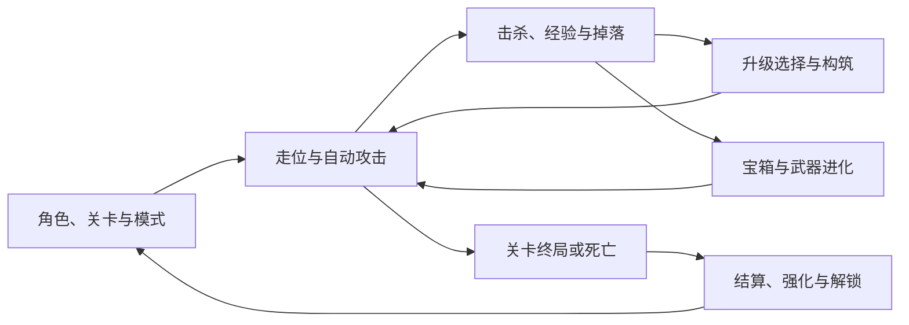

# 永夜余烬 H5：产品定义与开发路线图

更新日期：2026-10-31（北京时间）  
文档版本：0.2  
执行状态：已完成 M0 台账建模与 M1–M5 核心玩法、60 Hz 固定步长模拟、PixiJS 8（`pixi.js@8.22.0`）WebGL 战场渲染、三槽位存档、Web Audio 音频及游隙官方适配器集成（`implemented`）；待对照固定 Steam 构建实测后将逐项状态提升为 `verified`。

## 1. 目标与已定决策

第二款游戏《永夜余烬》（long-night-embers-h5）定位为哥特弹幕 roguelite 生存成长类单人 H5 游戏，参考同品类公有机制（自动攻击、经验拾取、升级三选一、波次出怪与武器进化），建立完整的自研规则与数值体系。本次只编写 roadmap 和研究记录；本文中的目录、命令、功能和指标均为后续实施规格，不表示已经完成。

本体版本、免费更新和 DLC 边界见 [品类公有机制参考与核对清单](./REFERENCE.md)。没有实际测得的参数仍标记待核对，不能把猜测写成设计事实。

| 项目 | 本轮决定 |
| --- | --- |
| 工作名称 | 永夜余烬 H5（Embers of the Long Night）；正式上架名称及封面在发布资料阶段确定 |
| 稳定标识 | `long-night-embers-h5`，用于入口、独立产物和存档命名空间 |
| 规划基准 | 哥特弹幕品类成熟通用版本的基础机制与内置更新内容 |
| DLC 边界 | 排除所有需要单独安装的 DLC，包括付费 DLC 与免费的独立联动 DLC |
| 实现范围 | 核心操作、敌潮节奏、自研角色、武器、被动、进化、关卡、遗物、模式、解锁、局外成长和单人冒险 |
| 首发设备 | 电脑浏览器，单人键鼠；移动端、手柄、合作模式列为独立后续范围 |
| 战斗渲染 | PixiJS 8 的 WebGL 渲染；准确包版本在实施时核实并锁入现有 pnpm 锁文件 |
| 菜单与界面 | 现有 React 19；React 不逐帧管理敌人、子弹或掉落物 |
| 战斗规则 | 本游戏独立 TypeScript 核心，固定步长模拟，与渲染、音频和存储分离 |
| 美术与音频 | 自制或许可明确的像素素材、图标与音频，保留清楚的武器和命中反馈 |
| 保存 | 本地档案、局内续玩、自动备份和 JSON 导入导出；不依赖平台登录 |
| 交付 | Vite 多入口开发；单游戏优先打包为独立 `index.html` |
| 接入 | 复用并核验仓库已有 `shared/platform/` 官方适配器封装，遵循游隙公开文档 |
| 本次变更 | 仅文档，不新增 `games/long-night-embers-h5/`，不上传、不建平台工作稿、不发布 |

### 1.1 基础版范围如何冻结

“基础版”指固定版本中，不安装任何独立 DLC 仍可游玩的内容，不只指 2022 年首发内容。已经通过免费补丁加入本体的机制和内容纳入范围，即使某机制最初来自 DLC。单独安装的免费联动包仍是 DLC，不能因为免费而混入本体台账。

- 本体角色、武器、被动、进化与联合进化、角色变身、敌人、Boss、普通/挑战/奖励/秘密等关卡均逐项登记。
- 遗物、地图、图鉴、音乐与解锁相关系统，以及 Hyper、Hurry、Inverse、Endless、Limit Break、Random Events 等在固定本体版本中存在的模式或功能，逐项核对并纳入。
- Arcana、Darkana、本体内的特殊成长和随从等新机制，按固定版本的实际归属登记；不以旧攻略遗漏新系统。
- 本体提供的 Adventures 纳入完整版本，独立 DLC 冒险排除；冒险与普通游玩的进度隔离规则另核对。
- 所有独立 DLC、公开测试分支、模组、合作玩法、Steam 成就服务、跨平台账号与云存档不进入本轮交付。

这些是范围分类，不是已核实的完整内容列表。完整清单必须在 M0 按原作 ID 与获得路径冻结；明确排除的项目也要留下原因，不能用“基础内容大致齐了”代替验收。

### 1.2 与平台已有游戏的关系

此前后台核查发现《菇勇者》是挂机装备成长，《像素回响》包含弹幕等小游戏，《余烬协议》是卡组冒险。它们与本项目有题材或局部机制交集，已有介绍未显示完整的“主动走位—自动攻击—拾取经验—随机升级—武器进化—限时生存—跨局解锁”循环。因此本游戏有独立立项价值，但不能声称平台没有任何类似战斗。

此前核查是历史快照，不是本次重新读取全部后台后的结论。M0 与上架前各复核一次实际游戏列表和玩法；若新增游戏已经覆盖同一完整循环，先调整立项边界再继续。当前不改已有游戏，也不把它们的代码或资产并入本游戏。

### 1.3 不加入的新玩法

本轮不自行增加体力、签到、装备抽卡、广告复活、战力排行榜、付费内容、离线经验、经营建设或网络对战。不把自动攻击改成手动瞄准射击，不把局外强化删成纯局内 roguelike，也不把原作限时关卡普遍缩短成五分钟。

素材风格、浏览器恢复和平台适配可以不同；改变伤害、升级选项、资源收益、地图行为或解锁条件的差异必须单独登记。

## 2. 参考版本、内容台账与完成标准

### 2.1 固定参考构建

M0 必须记录原作显示版本、Steam Build ID（可取得时）、正式/测试分支、语言、DLC 列表、模组状态和参考日期。官方公告用于定位候选版本；公告中的版本号不等于本机已验证的构建。

本次读取的官方公告给出稳定版 `1.16.111`，同时列出 public-beta `1.17.108`；前者作为 M0 的参考候选，后者不混入本轮范围。候选基线标识为 `vs-steam-base-1.16.111-candidate-2026-10-31`，实际冻结前仍需显示版本与构建观测。[版本证据](./REFERENCE.md)

参考环境固定为 Steam 正式分支、无模组、全部独立 DLC 关闭。后续官方更新不自动扩大当前 v1.0；新增内容进入另一次版本范围决策。官方旧版 itch 网页 demo 可用于快速体验自动攻击与走位，不能作为完整内容、现行参数或存档格式的依据。

证据和逐项待办集中维护在 [REFERENCE.md](./REFERENCE.md)。未取得实测证据时，可以推进不依赖它的技术验证，但不能替原作补造数字、填写 `verified`，或把未核实功能算入完成量。不会因为本计划默认购买游戏、读取私人存档或提取原作资源。

### 2.2 必须建立的内容表

| 表 | 必填字段 |
| --- | --- |
| 角色 | 稳定 ID、原作映射、归属、初始武器、基础属性、等级增益、特殊能力、获得条件、购买规则、来源 |
| 武器与被动 | 类型、等级上限、每级变化、权重、稀有度、标签、角色/模式限制、解锁条件、攻击行为、来源 |
| 进化与变身 | 输入与所需等级、条件物、是否要求满级、宝箱/时间/关卡限制、消耗与槽位结果、来源 |
| 敌人和 Boss | 属性、随时间/玩家变化的公式、移动与攻击行为、抗性、碰撞、击退、生成与掉落、来源 |
| 关卡与刷怪 | 地图规则、障碍、可拾取道具、出生/回收范围、时间轴、波次与数量、事件、终局和解锁 |
| 宝箱与掉落 | 来源、奖励池、数量/权重、可进化资格、金币规则、保底或例外、领取与动画时点 |
| 遗物与模式 | 获取条件、作用、开启/关闭、叠加规则、影响到的系统、跨局持久性 |
| Arcana / Darkana | 可选条件、效果与触发时机、叠加、例外、获取流程、关联武器/状态 |
| Survarots 等本体随从机制 | 取得路径、关联物品、生命周期、触发与效果、叠加、DLC 专属项排除、来源 |
| 局外成长 | 各强化效果、价格公式、上限、退款/重置、角色购买、Egg 等独立成长来源与开关 |
| 解锁与秘密 | 条件表达式、作用范围、奖励、结算/即时生效时机、计数、依赖链、提示与来源 |
| 冒险 | 章节、限定物品池、角色、初始状态、货币与成长、章节目标、重置/升阶与主档案边界 |
| 素材 | 文件、用途、尺寸/时长、许可或自制记录、压缩后体积、替代与归属 |

每条都有 `baselineId`、证据定位、`scope`、获得路径与状态。状态依次为 `pending → referenced → implemented → verified`；仅有数据、缺少正常获得路径的内容不得标成完成。

不以商店页总数作分母，不把 DLC、同一物品的别名、内部辅助对象重复计入。本体进化武器、隐藏角色和特殊关卡仍需有独立验收记录。

### 2.3 v1.0 的定义

1. 冻结范围内内容和关键规则逐项通过验证，覆盖率分别达到 100%。
2. 新档可以依照正常玩法推进到本体终局，遗物、秘密、模式和本体冒险的获得链均无断路。
3. 局内完整闭环、局外长期推进和断点续玩均可用；存档不因结算、导入、升级或多标签写入而回滚或重复发奖。
4. 代表性后期构筑达到性能门槛，不能靠删敌人、降低掉落或限制原作成长来过关。
5. 单游戏产物与平台接入通过验收；真实外壳联调在正式发布后单独确认。

只完成一张图、几把武器和三选一，称为原型或 Alpha。它可以帮助验证手感，不能作为“基础版完整复刻”交付。

## 3. 玩家体验与核心循环

玩家选择角色和已解锁的关卡/模式，进入战场后控制移动，由装备自动攻击；靠走位拉开空间，拾取经验与道具，在升级选择中形成构筑；击败精英取得宝箱，满足条件后获得进化；承受逐渐增强的敌潮，完成关卡或特殊目标；将结算收益和解锁带回档案，开启下一轮。



爽感来自逐渐成形的武器组合、清怪反馈和生存压力变化。前期攻击间隔、拾取范围、经验节奏和角色速度同样重要；不能只在后期堆粒子来替代核心手感。

## 4. 局内玩法规格

### 4.1 移动、相机与世界

- WASD 和方向键移动，斜向归一化；无移动输入时不自动漂移。具体速度、加速、受阻和击退行为以基线核对。
- 武器的朝向、最近敌人、随机方向、轨道或自动寻敌由各自规则定义；最后移动方向不能被 UI 点击意外改写。
- 世界坐标与屏幕坐标分开；像素绘制缩放、设备像素比和窗口大小不修改命中半径或移动速度。
- 标准展示使用 16:9 战场，参考逻辑画幅 960×540，放大显示；过窄窗口保持比例并提示放大。逻辑画幅是 H5 适配决定，M0 对照原作可视范围和屏外生成关系；若改变刷怪距离或收益，列入差异并修正，不能悄悄改变难度。
- 地图按真实规则处理重复地块、有限边界、走廊、障碍、隐藏区域和事件切换；不能把全部关卡换皮成同一个无限草地。
- 失焦、隐藏、平台遮盖、GPU 上下文丢失均暂停模拟，恢复时确认继续并清空残留按键；不补算隐藏时间。

### 4.2 自动攻击和武器模型

- 基础武器、进化与联合进化使用相同定义体系，但保留各自行为；不把所有攻击写成“向最近敌人发一颗子弹”。
- 区分冷却、发射间隔、数量、持续时间、范围、弹速、穿透、反弹、击退、命中间隔、概率效果和目标选择。
- 每个弹体/持续区域记录自身寿命、命中记录和武器归属；穿透命中、持续伤害、返回弹和范围伤害的重复命中规则分别核对。
- 角色、局外强化、被动、Arcana、模式和临时效果按明确顺序派生最终属性；不能在每次升级时直接改写基础值而产生永久叠加。
- 角色专属上限、武器上限选择、特殊角色、替换/变身与其他例外显式定义，不散落在渲染回调中。
- 战斗伤害、敌人死亡、经验与掉落只由核心提交；爆炸动画和声音结束不触发发奖。

### 4.3 生命、伤害与敌人

- 逐项核对生命上限、恢复、护甲、无敌间隔、接触伤害、受击反馈、治疗、护盾、复活和死亡。
- 敌人不仅有追踪移动，还可能有不同移动、远程、阶段、抗性和精英行为；不能用统一追人模型代替全部敌人。
- 生成波次、随时间/等级/模式缩放、场上数量控制和屏外回收必须来自基线，不以独立随机刷怪代替固定敌潮结构。
- 同一敌人死亡只生成一次掉落；死亡与玩家同时受伤、复活与终局同帧等场景必须确定处理顺序。
- 高速弹体需要扫掠或等价连续碰撞，不能因为低帧率直接穿过目标；空间索引只能减少候选，不改变结果。

### 4.4 经验、拾取与升级选择

- 经验掉落、宝石价值、合并/集中规则、吸附范围、飞向玩家的状态和经验曲线逐项核对；经验到账只提交一次。
- 一次大量经验导致多级升级时，逐次处理选择；未处理完不能直接跳过等级或一口气随机加点。
- 普通槽位以原作常规“最多六武器、六被动”为核对起点，特殊角色、模式、地面拾取和其他扩展槽规则单独验证；不能写成任何情况下都只能 6+6。
- 选项数量、权重、稀有度、已拥有物品的升级机会、幸运影响、满槽/满级后替代奖励、排除池按基线定义。
- Reroll、Skip、Banish、Seal 等分别处理局内次数、永久配置和候选池影响；没有候选时必须有合法流程。
- 打开升级界面即暂停战斗；选项及选择事务可保存。读档、重新打开面板或遮盖恢复不能免费重抽。

### 4.5 宝箱、进化和奖励

- 宝箱生成时与开启时分别记录需要的条件；进化资格按原作的关卡、时间、掉落来源和配方例外核对。
- 不采用“任意武器满级后，下一只箱子必定进化”的通用简化，也不默认每种进化都要求配件满级。
- 联合进化、赠礼等不同取得方式分别记录：消耗哪些武器、释放哪些槽位、是否额外占位、保留哪些配件、允许的多个进化顺序都纳入定义。
- 领取、抽取结果、金币、装备变化和动画状态分别持久化；动画跳过、重复点击和恢复存档不重复抽奖或发钱。
- 地图拾取物、宝箱物品和升级选项取得同一道具时，共用相同的槽位/等级合法性判定，但允许原作明确的不同规则。

### 4.6 时间、模式和终局

- 关卡时钟、刷怪时钟、角色技能、动画和真实耗时分别管理；Hurry 等功能具体加速哪些时钟按原作核对。
- 普通关卡的时间上限、阶段 Boss、死神、特殊终局和例外关卡分别记录。生存到时间限制并不自动等同于“击杀全部终局敌人”。
- Hyper、Inverse、Endless 与其他可组合模式，由条件与效果表组成；允许组合不代表效果简单相加，必须覆盖交互。
- Limit Break、Random Events、Gold Fever、Egg、各类商人和特殊角色机制，只要属于固定本体范围，就进入相应验证，不以“太后期”为由遗漏。
- 有继续条件的局面不提前判负，有明确终局的局面不无限刷怪；无尽局允许玩家主动结束并按真实规则结算。

### 4.7 Arcana、Darkana、遗物与秘密

- 遗物有真实的地图获得、解锁和界面入口；不在新档默认全开。
- 卡牌效果以有序触发点实现，例如发射、命中、死亡、拾取、升级和周期事件；每种效果明确叠加、递归及重入边界。
- 卡牌选择、再次获取、重抽和与武器的特殊联动按固定版本核对，不能把全部卡牌降为简单属性加成。
- 秘密条件、输入口令、棺材、特殊路线或临时事件在本体存在时须可完成。需要文字输入的页面不得抢走平台快捷键。
- 秘密解锁是正常内容的一部分；开发调试入口不能成为唯一获得方法。

Survarots 已有通过免费补丁进入基础游戏的官方说明；其本体取得路径、牌池与联动规则进入 M4/M5。独立 DLC 专属的牌、角色和地图依旧排除，不能按机制最早出现于哪个包就整套删去。[归属证据与 R35](./REFERENCE.md)

## 5. 局外成长与冒险

### 5.1 普通档案

保存角色和关卡解锁、收藏、遗物、强化、金币、秘密、统计及本体相关成长。购买价格、强化效果、价格随购买变化、退款/重置、角色特性和 Egg 开关等全部由台账定义。

成就式解锁与平台账号无关，按真实时机即时或结算提交；Steam 服务不可用不影响游戏推进。没有独立奖励的 Steam 成就展示，不伪造 Steam 通知或连接状态。

跨局进度不得根据“菜单显示过某项”判断。获得、发现、升级、存活时间、指定角色/关卡和模式条件是不同事件；统计与实际判定共用同一套稳定 ID。

### 5.2 本体 Adventures

本体冒险是完整版本的独立里程碑：章节选择、限定角色与物品池、章节目标、独立成长和重置/升阶按基线完成。主档案、冒险进度和共用设置的边界必须明确，不能让普通局强化意外污染冒险，也不能在退出冒险时覆盖主档。

不把 DLC 冒险混入，也不自行编写原创剧情补足未核实章节。本体冒险是否受新机制影响，以冻结版本为准。

## 6. 页面、交互与视听

### 6.1 页面清单

| 页面 | 必须可完成的操作 |
| --- | --- |
| 加载与错误 | 显示进度、资源失败原因、重试；加载失败不调用 ready |
| 标题 / 档案 | 新建、继续、选择本机档案、设置、操作说明；区分无续玩与损坏快照 |
| 角色 / 关卡 | 查看能力、购买与选择；展示解锁条件、已开模式和合法组合 |
| 战场 HUD | 生命、经验/等级、时间、金币、击杀、武器/被动、必要状态；不遮挡主要走位区 |
| 升级 / 宝箱 / 卡牌 | 键鼠选择、说明、合法重抽/跳过/放逐、动画跳过；重复提交无效 |
| 暂停 / 地图 | 查看当前构筑、已发现信息、音量、设置、继续、保存退出、结束本局确认 |
| 局外强化 / 收藏 | 购买、合法退款或重置、解锁条件、已见与未知状态，隐藏内容尊重剧透设置 |
| 终局 / 结算 | 结算原因、角色关卡模式、存活、收益、伤害统计与新增解锁、重开和返回 |
| 冒险 | 章节、独立成长、目标、完成与升阶，清楚标识当前进度所属 |
| 数据管理 | 导出、校验后导入、备份恢复、删除档案确认和存储失败提示 |

### 6.2 操作与布局

- WASD / 方向键移动；Esc 暂停或返回当前层级；Enter 确认已聚焦按钮。鼠标可完成菜单与选项操作。
- 输入框编辑时不触发移动；平台 Alt/Option 快捷键保留给官方适配器，不自行覆盖。可重绑的游戏键不得与平台保留动作冲突。
- 目标桌面 1280×720 及以上，1024×640 保持菜单可用；窗口变化不重新开局。首发不声明触屏或手柄支持。
- 提供独立音乐/SFX 音量、总静音、伤害数字密度、闪光/震屏强度和清晰模式。降低特效只改变呈现，不减少攻击、经验或怪物。
- 升级与卡牌说明可以暂停阅读；隐藏信息按原作发现进度展示，不在首次新档直接剧透全部进化。

### 6.3 美术、音效与反馈

使用清楚的像素角色、敌人轮廓和图块，统一像素密度；攻击覆盖、拾取、受伤、升级与进化有不同反馈。伤害数字与粒子不能盖住玩家，Boss 和危险攻击保持辨识度。

优先图集、重复地块和短音效；音乐按关卡/事件需要准备。自制或合法素材记录来源，未完成的临时素材标记清楚。素材加载完成、解码成功后才允许进入使用它的场景，不用远程字体或 CDN 作为运行依赖。

## 7. 工程架构

### 7.1 渲染与框架选择

战场采用 PixiJS WebGL，菜单采用 React，规则采用独立 TypeScript。Pixi 官方文档支持异步初始化并提供 WebGL 渲染路径；该选择用于大量 2D 对象的绘制，不让框架代管游戏规则。[Pixi Application](https://pixijs.com/8.x/guides/components/application)、[Renderers](https://pixijs.com/8.x/guides/components/renderers)

实施时再安装并锁定实际稳定版本。不开第二套 Phaser/物理引擎，不先搭通用 ECS、插件总线或跨游戏战斗引擎；本游戏规模需要的实体表、系统函数、空间索引和对象复用即可。WebGPU、Worker 和 WASM 不作为首发前提；WebGL 不可用时给出明确错误，不假设存在自动 Canvas2D 降级。

### 7.2 计划目录

以下目录仅用于约定边界，本次不创建空目录：

```text
games/long-night-embers-h5/
  index.html
  game.json
  assets/              图集、图块、图标、音乐、音效与来源记录
  src/
    main.tsx           单游戏入口
    app/               React 页面、HUD 与选择面板
    runtime/           启停、固定步长、输入、暂停原因和生命周期
    core/              世界、战斗、掉落、升级、进化、事件与结算
    content/           固定基线、内容定义、解锁图与验证器
    render/            Pixi 视图、相机、图集、特效与对象回收
    audio/             Web Audio 总线与音量控制
    persistence/       快照、事务、迁移、导入导出与备份
    platform/          本游戏状态与共享官方适配器的连接
  tests/               核心规则、进度、重放与浏览器场景
docs/games/long-night-embers-h5/
  ROADMAP.md
  REFERENCE.md
```

仅 `shared/platform/` 等已经确有共同需求的薄封装共用。不得导入 `games/card-realms-h5/` 的业务代码；各游戏保持业务模型与存档完全隔离。

### 7.3 状态与规则边界

| 对象 | 负责的状态 |
| --- | --- |
| ContentDefinition | 不可变 ID、参数、行为类型、来源、范围与版本 |
| Profile | 档案、永久货币、解锁、强化、收藏、冒险分区与提交记录 |
| Run | runId、角色/地图/模式、模拟 tick、随机流、阶段、局内统计与待提交收益 |
| World | 玩家、敌人、弹体、持续区域、掉落、地图事件、可恢复的定时器 |
| Build | 装备与等级、额外槽位来源、Arcana/Darkana、临时效果与派生属性 |
| Choice | 固定候选、剩余选择、重抽/跳过次数、提交状态 |
| Settlement | 本局最终收益、解锁、唯一结算 ID 和提交状态 |

核心不保存 React/Pixi/AudioNode 引用；快照都是可序列化数据。UI 只能提交明确命令，不能直接改生命、装备或金币。数据 ID 唯一、引用存在、获取链可达；异常输入先验证再进入核心。

### 7.4 模拟时钟与随机性

- 采用 60 Hz 固定模拟步长和 rAF 渲染，这是 H5 工程选择，不声称复制原作引擎频率。
- 冷却、生成、伤害、拾取和关卡事件在模拟时钟上执行；渲染插值不修改规则。菜单动画可以继续，战斗计时暂停。
- 每次绘制最多补五个模拟步；保留未处理的累积量。若积压持续超过 250 ms，转入性能暂停并提示降低视觉设置，避免把积压一口气补成玩家死亡。具体阈值在 M1 压测后记录；该保护作为 H5 差异，不偷偷丢掉刷怪或攻击。
- 所有玩法随机使用保存状态的种子生成器，按已定义顺序调用；视觉随机独立，关闭粒子不会改变掉落。不同随机流不得擅自改变已经验证的分布和依赖。
- 固定内容、种子、输入与命令日志应在本项目支持环境中可重现关键结果；不承诺与原作种子一一对应，也不在没有验证时承诺跨所有浏览器浮点逐位一致。

### 7.5 性能实现边界

空间网格用于碰撞候选，图集与批量精灵用于渲染，弹体/数字/粒子复用避免频繁分配。只在测量显示需要时增加更复杂的数据布局；先不创建通用 ECS 或为每种武器新建类继承树。

屏幕外敌人、经验宝石合并和对象上限按原作规则处理。只允许裁剪绘制和限制纯视觉对象；不能用“性能优化”删除有效伤害、敌人、经验或宝箱。React 通过低频派生快照或订阅更新 HUD，帧内位置留在 Pixi。

## 8. 存档与断点续玩

### 8.1 档案组织

H5 端提供三个本机档案，每档一个当前局续玩点；普通游玩与冒险的持久状态分区，是否允许同时保留两类进行中局在 M0 对照后固定，首版不自行允许复制分支。同一档案同时只允许一个窗口写入。

使用 IndexedDB 事务保存档案与快照，必要的小型 Promise 封装留在本游戏；不依赖 `localStorage` 每帧存整个世界。记录 `schemaVersion`、`contentVersion`、`baselineId`、`profileId`、`runId` 和修订号，保存最近三份可恢复备份。

三个档案、续玩和备份是 H5 产品决定，不冒充原作当前存档能力；与原作保存规则的差异须显式展示。

### 8.2 局内快照

快照包含模拟 tick、随机流、世界对象、武器定时器、命中状态、地图事件、掉落、构筑、待选择与宝箱结果、已取得但尚未结算的奖励。只保存角色和时间然后重新生成整张战场不满足续玩要求。

- 有变化时每十秒请求一次安全 tick 边界的自动快照；升级、宝箱、遗物、关键解锁与保存退出后优先保存。
- 页面隐藏与离开时尽力保存，但不承诺浏览器强杀一定成功；界面显示最近一次成功时间。刷新最多回退到最后成功快照，不抹掉档案。
- UI 动画读档后可重新播放或跳过，核心结果不重新抽取。暂停原因按当前环境重建，不把旧平台遮盖状态永久写死。
- 存档失败保持本局运行与内存状态，提示导出/释放空间；失败写入不得覆盖上次成功档案。

### 8.3 收益与解锁的一致性

局内奖励、即时解锁和终局结算分别按基线时机提交，并使用稳定事件/结算 ID 去重。同一次结算的档案更新、收益标记与续玩清理在同一事务内完成；崩溃恢复不重复加金币，也不吞掉已完成解锁。

本地存档可以被玩家编辑，本轮不建立反作弊服务。仍需校验数据结构、有限数值、ID 引用、版本和尺寸，防止损坏文件导致崩溃。单次 JSON 导入上限先设 32 MiB，超限提示而不读取；M3 用最大合法压力快照校验，若不足则在发布前调整并记录。

导入先校验与迁移，在新事务成功后才替换；先备份旧档，失败保留原档。多标签通过单写者锁及修订检查阻止覆盖，其他窗口只读提示接管，旧写者失去资格后不能继续写。

### 8.4 升级与平台边界

迁移测试覆盖 schema 升级、内容 ID 重命名、已移除临时项和旧快照不兼容。无法安全恢复旧局时保留档案及可导出数据，明确提示原因，不能静默重开或清档。回退包需记录支持的存档版本；旧包不能覆盖新格式。

平台身份只用于显示昵称，不切换本机档案、不清空进度、不当登录凭据。本地开发、候选预览与正式游戏子域是不同来源，存档不会自动互通；需要时使用玩家主动导入导出。平台目前没有统一云存档。[游隙游戏接入](https://scalia.ltd/docs/game-integration)

## 9. 游隙接入与交付规范

本节按 2026-10-31 读取的公开文档编写；实际实施和发布前再次核对。已有适配器只解决协议封装，不能替本游戏完成暂停、音频和 ready 验收。

### 9.1 协议与运行状态

| ID | 要求 | 本游戏验收场景 |
| --- | --- | --- |
| P01 | 仅 iframe 内连接，可信平台来源固定 `https://scalia.ltd` | 顶层单独启动正常；伪造来源和旧实例消息不改变游戏 |
| P02 | 官方适配器本地打包 | 发布包无远程脚本依赖，不自行改成通配 postMessage |
| P03 | 真正可玩后 ready | 资源、场景、输入与初始可运行局准备好后报告；仅标题/进度条或加载失败不算成功游玩 |
| P04 | 独立暂停原因 | manual、choice、chest、map、sidebar、boss、hidden、contextLost 等分别维护；解除一个不清空其余 |
| P05 | 同步临时静音 | 现有与新建音源在回调返回 true 前都受中央静音控制；用户音量独立保留 |
| P06 | 身份热更新 | 游客/登录/退出/昵称变化不重载，不重置局，不切档 |
| P07 | 侧栏与快捷键 | 适配器接收平台偏好；侧栏叠盖不按 resize 重建战场；Alt/Option 组合不被游戏抢占 |
| P08 | 外壳权限 | 不单独请求游戏全屏、不顶层跳转或弹窗；不把管理凭据放入前端 |
| P09 | 来源与存档 | 正式稳定独立游戏来源保存进度；更新后正常读档，预览与正式来源隔离被清楚说明 |

`isRunning()` 返回战斗模拟是否实际推进；标题、升级、暂停、结算或性能保护时返回 false。`ready()` 每个 iframe 启动只报告一次，不在每次重开新局时重报。首局外壳处于遮盖状态时，游戏可以准备完成，但保持对应暂停与静音。

Web Audio 所有声音经过音乐/SFX 分组后进入中央输出 GainNode。`setTemporaryMuted` 同步设置总输出状态再返回 true；新音源播放前读取同一状态。用户手势解锁 AudioContext 与平台静音分开处理，恢复遮盖不能自动重新打开用户已静音的声音。

协议、身份、暂停与音频要求来源：[游隙游戏接入](https://scalia.ltd/docs/game-integration)。

### 9.2 单 HTML 与静态包

沿用现有多入口发现机制。实施时才创建游戏入口；目录页只读元数据，不预先下载 Pixi 或其他游戏。

目标产物是 `dist/games/long-night-embers-h5/index.html`，JS、CSS、官方适配器、图集与音频均由构建纳入，验证无运行时外部依赖。图片/音频必须实际核对内联方式，不能把插件成功运行等同于资源已全部内联。

本项目发布包目标不超过 30 MiB，包含 base64 膨胀后的最终文件；这是体积目标，不是平台限制。优先压缩图集、音频和移除无用素材，不能以体积为由删除范围内玩法。若完整内容无法合理装入单 HTML，先提交测得的体积与完整静态包方案，记录交付决策后再变更目标，不静默换交付形式。

平台当前硬限制：ZIP 100 MiB、展开后 500 MiB、最多 10000 文件、单文件 64 MiB。独立 HTML 也受单文件限制。封面可用 PNG/JPEG/WebP/AVIF，最多 512000 字节且不超过 1600 万像素；入口和相对资源必须完整。[游隙上传与发布](https://scalia.ltd/docs/publishing)

发布包不含开发目录页、第一款游戏、源码、缓存、测试、密钥或管理凭据。整站 `dist/site/` 不能当作本游戏发布目录；单游戏构建不得清理其他游戏的产物。

### 9.3 平台验证分两个阶段

发布前用本地可信测试宿主验证消息、暂停、静音和失败流程，再用私有候选顶层预览检查资源、入口、玩法与存档。候选预览不是正式游玩外壳，不把其结果算作真实身份、快捷键和最近游玩验证。

实际发布后在 `/play/<slug>` 验证稳定子域 HTTPS、身份变化、侧栏、防 Boss、快捷键、音频、最近玩过、更新后存档与外壳全屏。正式发布前记录这些项目为待执行，不伪造通过结果。[接入与预览说明](https://scalia.ltd/docs/game-integration)

本路线图不授权上传或发布。后续用户要求发布时，按“读取当前资料与修订 → 工作稿与文件 → 冻结不可变候选 → 检查 → 发布该候选”的流程执行。资料只声明 `desktop`，分类取平台实际分类，slug 先检查重复；每次修订保存相应版本与回退信息。[发布流程](https://scalia.ltd/docs/publishing)

## 10. 开发阶段与退出条件

不先估日历工期。M0 完成内容规模与技术验证后，再按台账和实测性能估算；每阶段只以退出条件是否满足判断完成。

| 阶段 | 交付内容 | 退出条件 |
| --- | --- | --- |
| M0 基线冻结 | 固定原作构建、范围/排除清单、全部内容 ID、获取依赖图、公式与规则核对计划、平台同类复核 | 内容分母和来源明确；首个垂直切片需要的全部规则实测；后续未知项有明确阻塞阶段 |
| M1 战斗与平台底座 | 独立入口、Pixi 生命周期、移动/相机、固定步长、代表性攻击与敌人、经验拾取、暂停、早期接入/音频样机、压力场景 | 操作无粘键；不同帧率模拟一致；平台遮盖可暂停静音；显式支持/拒绝 WebGL 环境；首轮性能通过 |
| M2 局内垂直切片 | 一个完整正常关卡的开局到终局；升级池、槽位、宝箱、至少一条真实进化链、死亡/复活与结算 UI | 能完成对应原作流程，升级/宝箱事务稳定；仅称原型，不宣称完整版本 |
| M3 主线 Alpha | 本体关键推进链、局外成长、遗物/模式框架、角色和武器扩展、三档案、完整续玩、导入导出与迁移 | 新档可推进至本体关键终局；保存恢复与结算去重测试通过；核心公式已核对；早期/中期性能通过 |
| M4 战斗内容完整 Beta | 固定本体全部关卡/角色/武器/被动与进化、敌人、特殊终局/秘密，Arcana/Darkana、后期模式、Survarots；含固定免费补丁的对应内容 | 此范围逐项可获得并验证；例外构筑、交互模式和后期压力场景通过，无占位规则 |
| M5 内容完整 Beta | 全部本体冒险、收藏/提示/统计、视听完成、全台账与解锁图复核；不另追新补丁 | 所有范围内内容进入 verified；无 DLC 混入；普通档与冒险隔离、终局与全部获取路径通过 |
| M6 发布候选 | 跨浏览器、2 小时稳定性、性能复测、旧档迁移、体积、独立 HTML、平台测试宿主、封面资料与候选检查清单 | 发布前检查全部通过；真实外壳项目明确待发布后执行；形成可审核产物及报告 |
| v1.0 正式验收 | 用户要求发布后完成候选发布与真实外壳检查 | 内容/规则/正常推进/存档/性能/实际平台联调均通过，记录版本与回退方案 |

M1 的攻击与敌人样本必须覆盖接触、直线弹体、持续范围和多目标压力；它们是技术验证样本，不把临时设计写入正式内容。M3 的关键路径通关不代表 M4/M5 可省略；M4 也不因冒险尚未完成就改称完整正式版。

每阶段交付：实际变化、台账状态、测试结果、未完成与阻塞、H5 差异更新。未知规则可以阻塞它依赖的阶段，不能用硬编码占位后把阶段标记完成。

## 11. 验证方案

### 11.1 规则与数据

核心测试使用固定内容、种子和虚拟 tick，重点验证真实边界，避免只镜像实现。现有仓库已有 Node 测试入口；实施时为本游戏建立独立测试命令并保留第一款的测试，若确有需要再引入其他工具，本次不安装。

| 场景 | 通过标准 |
| --- | --- |
| 帧率与时钟 | 同输入在不同渲染帧率下，移动距离、攻击次数、刷怪与收益一致；隐藏不推进 |
| 命中与伤害 | 穿透/范围/持续攻击、接触无敌、护甲、复活、同时死亡按基线；单次死亡不双发奖 |
| 升级池 | 满槽、额外地面道具、满级、无候选、幸运、重抽/跳过/放逐/封印行为可复现 |
| 进化 | 正常/联合/特殊配方、宝箱来源/时间限制、槽位释放、多个候选与不满足条件均正确 |
| 效果叠加 | 角色、被动、强化、模式、Arcana/Darkana 的代表性组合与递归边界正确 |
| 保存恢复 | 战斗、升级面板、宝箱动画、终局前后恢复后状态/随机一致，收益不重复 |
| 解锁与冒险 | 条件/获取链可达，临界计数正确，普通/冒险进度不会互相污染 |
| 内容验证 | ID 唯一、引用有效、DLC 标签正确、全部获取链无断路、排除项有理由 |

原作对照中，公开说明只确认系统存在时不能给数值打勾。随机机制先核对规则与条件概率；采用有记录的样本、容差和置信范围，不用少量掉落就宣布概率完全一致。涉及离散确定规则时要求精确一致。

### 11.2 必须正常游玩的流程

1. 新档从初始角色开始，正常获得首批强化、角色和关卡，无调试解锁。
2. 完整常规关卡，从早期弱势到多武器成型、进化与终局，验证敌潮节奏。
3. 特殊角色、额外槽位、联合进化与满级候选耗尽，验证构筑例外。
4. 遗物和本体主线推进，包含特殊终局及后续模式的正常解锁。
5. 代表性后期 Arcana/Darkana、Limit Break 与无尽构筑，验证性能和规则没有裁剪。
6. 一套本体冒险从章节开局到完成/升阶，检查独立进度及返回主模式。
7. 局内断点续玩、宝箱中刷新、结算时异常关闭、旧档升级、导入失败与多标签接管。
8. 真实平台遮盖发生在移动、升级、宝箱、复活和结算时，恢复保持原有暂停/音量/进度。

浏览器测试覆盖实际键盘、指针、焦点与菜单操作；不是只调用内部函数。涉及平台身份和最近游玩，保留发布后的真实外壳记录。

### 11.3 性能目标

以下是工程验收目标，尚未实测，也不是原作公布的对象上限。

- 固定测试机：Windows、四核 CPU、8 GB 内存、集成显卡，记录准确型号、系统、浏览器、分辨率和电源模式；输出 1280×720，DPR 上限 2。
- 常规压力：同时 1000 敌人、2500 弹体/区域和 2000 掉落实例，持续五分钟，目标 60 FPS，帧间隔 p95 ≤ 20 ms。
- 后期压力：同时 2000 敌人、5000 弹体/区域和 10000 掉落实例，目标至少 30 FPS，帧间隔 p95 ≤ 40 ms；低特效设置仍保留全部玩法实例。
- 输入至可见移动目标 p95 ≤ 100 ms；定时保存不得反复产生超过 100 ms 的长任务。快照体积与写入耗时单独记录。
- 必须再跑固定本体版本可达的最差代表性构筑；若它超过上述对象数量，不能因合成压力已通过就跳过。
- 连续游玩两小时，至少十次重开，检查内存、纹理、音源、事件监听和 ticker 数量无持续增长；GPU 恢复不清档。
- 浏览器以验收时正式稳定版 Chrome/Edge 为主，Firefox 单列实测；未通过的浏览器不写进支持声明。无 WebGL 环境提供可读错误。

若目标机无法达到门槛，先分析 CPU/GPU、批处理、碰撞和分配，调整纯视觉档位。确需改变支持设备或玩法范围时先更新决策记录，不能用隐藏删怪通过指标。

## 12. 实施与发布前清单

### 12.1 本次文档验收

- [x] 确认品类通用玩法调研基线，锁定参考机制版本与数值边界。
- [x] 明确独立 DLC 与内置免费更新的边界，首发设备、模式与技术路径已定。
- [x] 核心、局外、冒险、存档、性能、平台与打包均有规格和阶段门槛。
- [x] 原作来源与未知规则集中在 REFERENCE，不虚构数值与完成数量。
- [x] 不新增游戏入口、不修改游戏逻辑、不安装依赖、不操作平台发布。

### 12.2 后续实现验证

按仓库当前 pnpm 约定执行；只有实际创建入口后才有该游戏构建命令：

```powershell
pnpm run typecheck
pnpm run lint
# 实施时再新增并执行本游戏独立测试命令，同时保留已有游戏回归
pnpm run build
pnpm run build:game -- long-night-embers-h5
```

- [ ] M0 参考构建与内容全集冻结，关键数值实测，有合法证据。
- [ ] 台账 verified 覆盖率 100%，正常获取链与主线/冒险通过。
- [ ] 升级、进化、特殊角色、模式与卡牌交互验证完整。
- [ ] 保存恢复、事务去重、多窗口、备份、导入和升级迁移通过。
- [ ] 代表性后期构筑、低特效与两小时稳定性通过。
- [ ] 单 HTML 通过 HTTP 与目标平台静态托管检查，无外部资源依赖。
- [ ] 构建没有混入目录页、另一款游戏或秘密文件；大小、入口和封面合规。
- [ ] 测试宿主与候选检查通过，发布资料只声明实测设备与类别。
- [ ] 用户要求发布后，检查正式外壳与升级后存档，记录实际发布版本。

## 13. 风险、差异与后续范围

| 风险 | 处理方式 |
| --- | --- |
| 免费内容不断增加，范围无法收口 | 固定正式构建与内容台账，新补丁另立范围；不跟随公开 beta |
| 玩法存在但公式/条件不明 | 进入 REFERENCE 阻塞表，取得同版本观测，不能凭感觉补齐 |
| 后期效果组合导致性能恶化 | M1 提前压力验证，M4 用可达构筑验证；只裁剪视觉，不改变规则 |
| 续玩重复奖励或随机重抽 | 保存候选/结果/随机流，唯一事件 ID 与 IndexedDB 原子提交 |
| 新游戏引入引擎影响旧游戏 | 独立入口导入 Pixi、独立业务目录与构建；复用仅限明确公共边界 |
| 单文件资源膨胀 | 提早测内联图集/音频，30 MiB 目标与平台 64 MiB 单文件硬限制分别检查 |
| 候选预览被误当外壳联调 | 发布前测试宿主与文件预览、发布后真实外壳分开记录 |

已知 H5 适配决定：电脑优先、独立本机档案、断点续玩、浏览器隐藏暂停、低帧率保护、WebGL/React 分工、自制素材、平台昵称仅展示。每项继续细化为“原作行为、H5 行为、原因、对收益/难度的影响、验证方法”，不能用一条“浏览器不同”掩盖全部差异。

v1.0 后依次考虑手机触控与横竖屏、手柄、更多浏览器与表现优化；合作模式、DLC 或原创扩展必须另写范围和验收，不作为当前计划的隐藏依赖。当前下一步仍是 M0 的资料与基线核对，游戏开发需用户另行明确要求。
