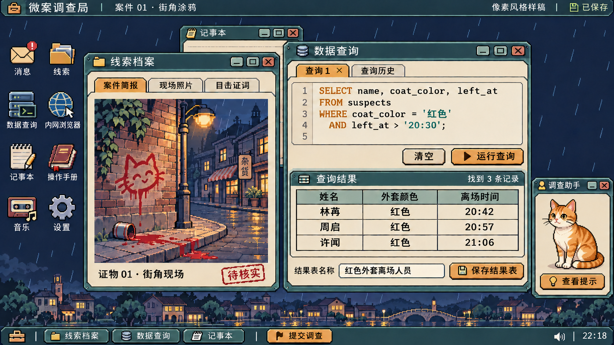

# 微案调查局 H5：开发路线图

更新日期：2026-11-07（北京时间）  
状态：已完成 M1–M6 本地实现、十案端到端游玩验证与平台协议自测；暂未登记至 `deploy/games.json` 发布清单。  
工作名称：微案调查局；目录标识为 `minor-case-bureau-h5`。

## 1. 游戏目标

玩家在一台虚构的调查局电脑上处理案件：接收简报，阅读证词和图片，查阅数据表，用 SQL 缩小嫌疑范围，再沿着网页、账户、交易和人物关系继续调查。提交调查结果后，系统根据证据给出反馈，并推进后续案件。

完整版本包含 10 个案件、8 章操作手册、一套可交互的桌面，以及贯穿案件的虚构网络。前期教玩家筛选和关联数据，后期要求玩家自行寻找资料、判断信息之间的关系。最后一案包含内容编辑、发布和结局分支。

当前交付为规划与 UI 风格确认。下文均为待开发规格，阶段样例通过不代表整款游戏完成。

## 2. 产品与文案约定

| 项目 | 约定 |
| --- | --- |
| 首发形态 | 单人 H5，优先电脑浏览器与键鼠操作 |
| 内容范围 | 十案主线、案件内分支、错误提交、案件回顾、结局，以及调查所需的全部工具与网页交互 |
| 中文范围 | 菜单、按钮、对白、教程、线索、网页、邮件、错误提示和结局均使用简体中文 |
| SQL | 保留标准关键字与可输入的标识符；教程给中文释义，表结构同时显示中文字段说明 |
| 叙事 | 重新创作城市、机构、人物、站点品牌、对白和案件文字；保留每条线索的条件、关联关系与推理作用 |
| 图片 | 生成角色、物件、场景和证据图片；具有破案作用的文字、号码与标记由程序叠加 |
| 音频 | 使用新制作或许可明确的音频；案件简报须有完整中文字幕，配音与音效单独验收 |
| 保存 | 本地自动保存，支持退出后继续调查；不同案件、不同游戏的状态隔离 |
| 交付形式 | 仓库独立游戏入口、整站构建和独立游戏产物 |

中文文案由 `agy` 的 Gemini 4 起草并定调，项目侧核对线索条件、操作后果、术语和前后一致性；编辑时遵循 `humanizer-zh` 的要求。对白可以带幽默，操作提示须先说明发生了什么，再说明玩家能做什么。润色不能改动时间、金额、数量、否定条件、人物关系或提交后果。

不增加体力、每日任务、付费提示、广告复活或排行榜。首发范围不含第三方账号、社区订阅和云存档服务。自定义案件、本地导入等入口是否属于交付范围，在 M0 单独定案，不与十案主线混算。

## 3. 视觉方向

2026-11-07 已确认采用“像素侦探桌面”：深蓝雨夜背景、灰绿窗口标题栏、米白阅读区和琥珀色按钮。图标、角色、证据插画与窗口边框统一采用清晰的像素风，中文和 SQL 保持足够字号与对比度。保留桌面图标、多窗口、任务栏和资料夹的操作结构，让玩家能同时查看线索、网页和查询结果。

调查助手采用自然猫形的橘白像素猫，使用真实猫的身体比例和蹲坐姿态，不穿衣、不戴饰品，不使用人类站姿或手势。角色位于可收起的助手窗口内，不遮挡查询、结果表或保存操作。表情与动作服务于提示状态，不能透露案件答案。



样稿通过内置图片生成工具制作，[本次局部替换的生成提示词](./art/ui-pixel-cat-v2.prompt.txt)一并保存。该图用于确认视觉方向，窗口交互与文字仍须在游戏中实际实现。

文字、按钮、表格、窗口边框和图表由代码绘制。生成图主要承担角色、证据物件、场景插画和装饰，避免把可交互界面烘焙成一张图片。

主界面方向与助手类型已经确认。后续以确认稿统一一组应用图标、助手表情和三类证据图片，再批量制作正式素材。所有素材记录用途、生成批次、尺寸和采用状态。

证据图必须能读出解题信息。涉及衣着、颜色、人数、位置、时间或号码的图片，逐项检查；不能把生成图中的偶然细节变成额外线索，也不能用模糊画面掩盖必要条件。字体须覆盖中文、数字和 SQL 符号。

## 4. 必须完成的交互

### 4.1 桌面与窗口

- 应用图标能够打开对应程序；桌面选择、拖动和右键菜单按确定后的操作表实现。
- 窗口支持聚焦、前后层级、拖动、关闭、最小化和任务栏恢复；窗口尺寸调整与多开规则在 M0 确定。
- 关闭、最小化和切换窗口有各自的状态语义。隐藏窗口后，查询草稿、网页位置和记事内容仍能恢复。
- 长文与表格能滚动，弹窗不会落在屏幕外；浏览器缩放后仍能找回窗口。
- 快捷键按应用和输入焦点分配，输入中文时不误触桌面命令，编辑器撤销不影响其他窗口。

### 4.2 消息、简报与线索

- 新案通知、简报收听、文字记录、未读状态和历史消息均可使用。
- 线索夹包含文字、证词、证件、照片、名片和其他案件附件；各附件支持所需的查看、翻页、放大和复制操作。
- 图片与文字中的时间、地址、账号和人物信息能对应到数据库或网页。
- 新资料按案件阶段解锁，通知能够打开相应内容；刷新后不丢附件，也不重复发放。

### 4.3 数据表与 SQL 工作台

- 查看表名、字段、数据类型和数据行；支持滚动及经过确认的排序、选择、复制行为。
- 提供多行编辑、语法高亮、执行、查询历史、恢复查询、撤销和重做；多查询页签的数量与保存规则列入操作表。
- 编写时提供 SQL 关键字、表名和表内列名（字段名）的补全；`FROM`、`JOIN` 后优先提示当前可访问的表，输入表名或别名加 `.` 后提示对应字段。候选显示可插入的标识符、中文说明和适用的数据类型，按已输入内容筛选。
- 补全数据来自本局实际可查询的表结构，包括已取得的数据表和玩家保存的结果表。下载、建表、重命名和删除后同步更新；未取得的资料和其他案件的表不得出现在候选中。
- 正确处理表别名、同名字段及所在查询作用域；识别不了尚未写完的语句时保守提示，不把其他表的字段当作当前表字段。悬停说明解释字段含义，函数提示说明参数与用法，通用查询片段保留待填位置。
- 支持自动弹出候选、手动唤出提示、键盘选择、明确接受和关闭；中文输入法组词期间不抢焦点、不误选候选。提示仅辅助编写，不自动执行查询，不插入案件答案或尚未取得的线索。
- 括号与引号配对、缩进、错误标记和中文错误说明一并纳入编辑体验。未完成语句的提示与执行错误分开处理，错误标记须来自实际检查，不能把所有半句都报成错误。
- 查询结果生成可继续使用的结果表，能够命名、保存、重命名和删除；明确临时表与保存表的生命周期。
- 保存的中间结果能被后续查询引用。表名冲突、字段歧义、空结果与不存在的表都有中文反馈。
- 执行玩家输入的真实 SQL。不同但等价的写法应得到一致的结果，不按预设答案字符串返回固定数据。
- 覆盖十案所需的筛选、布尔条件、模式匹配、排序、去重、连接、分组、聚合、子查询、集合运算、表达式和相关函数。M0 逐项确定语法边界与例外。
- 错误提示尽量指出出错位置、原因和可修改方向。查询失败后保留输入，不把超时、语法错误与零条结果混为一谈。
- 控制慢查询与结果体积，支持结束执行或可靠超时；异常查询不能卡死整个桌面。
- 原始案卷数据与玩家创建的数据分开管理。允许的建表、改表和删除操作须写清对象与范围。

### 4.4 虚构网络

- 浏览器支持地址输入、站内链接、前进、后退、刷新、历史和书签；页面返回时恢复必要的滚动与表单状态。
- 站点既有公开页面，也有搜索、登录、个人资料、帖子、评论、管理页和可下载数据。
- 按案件需要提供餐饮、旅宿、新闻、机构、校园、游戏社区、交易、企业与人物资料等站点；M0 冻结完整站点和内页清单。
- 登录、回帖、留言、答题、下载、填写资料和发布操作确实改变对应状态；错误输入有反馈。
- 下载得到能查询的数据或可查看的线索。重复下载、无权访问、链接失效和搜索无结果均有明确行为。
- 网页内容、搜索结果、账户信息与案卷来自同一份案件数据，不能出现网页与数据库对不上人的情况。
- 所有调查站点在游戏内运行。输入不存在的地址时显示站内反馈，不跳转到真实网站。

### 4.5 助手、手册与记事本

- 助手根据当前案件、调查阶段和已取得的资料给出提示，区分“下一步查什么”和“SQL 怎么写”。
- 提示逐步展开，已看提示可回顾；不因打开窗口就直接泄露答案。
- 手册包含封面、8 章内容、章节选择、翻页和进度解锁。代码示例可复制，示例能实际执行。
- 记事本支持中文输入、选择、复制粘贴、撤销重做及已确定的颜色或分页操作；内容自动保存。
- 复制表格值、网页文字或线索后，能粘贴到查询框与记事本；浏览器不允许访问系统剪贴板时仍有游戏内复制方式。

### 4.6 提交、反馈与结局

- 逮捕窗口校验人物标识、当前嫌疑范围和重复提交，确认页说明本次操作的后果。
- 正确与错误提交分别触发对应的消息、记录和后续状态；错误累计、停职或重试条件在 M0 确定。
- 案件回顾可以重新进入已开放的案件；重新调查是否更换数据、保留哪些记录，须有明确规则。
- 最后一案包含编辑、预览、确认发布及相应结局。检查标题、正文和数据内容如何参与判定，不能只校验最后一个按钮。
- 所有可达结局均有完整文本与流程，能正确返回可继续操作的界面。

### 4.7 设置、音频与恢复

- 主音量、音乐、音效、静音和适用的显示选项可调整并保存。
- 音乐播放器的选曲、播放、暂停及其他已确定控制均可操作。
- 页面失焦、手动暂停和平台暂停分别处理；暂停期间不继续播放简报或推进定时剧情。
- 恢复存档时还原案件数据、调查阶段、查询草稿、保存表、笔记、网页记录、提示进度和提交记录。
- 新开游戏、重开案件与清空全部记录是不同操作；确认页准确说明会删除什么。

## 5. 十案内容安排

以下是开发用案名和任务安排。具体表结构、资料数量、阶段条件与分支在 M0 写成可执行规格；案名可以调整，推理链不能在制作中被省略。

| 案件 | 调查内容 | 该案必须跑通的流程 |
| --- | --- | --- |
| 01：街角涂鸦 | 从目击描述与嫌疑人资料中识别人选 | 接案、阅读描述、首次查询、打开结果、提交与反馈 |
| 02：被丢下的东西 | 将现场物件、身份资料与人物信息对应起来 | 图像取证、组合条件、排除同名或相似人选 |
| 03：消失的午餐 | 核对人员与进出时间 | 连接多张表、判断时间区间、解释谁可能在场 |
| 04：迟迟不退的房间 | 结合旅宿记录、照片和关联身份查人 | 多条线索交叉验证、保存中间结果、识别身份关系 |
| 05：餐厅里的“重案” | 结合订单、菜单、消费和证词缩小范围 | 网站调查、数据下载、金额与比例计算、聚合后筛选 |
| 06：匿名留言 | 从帖子、访问时间、网络记录与人物资料追踪身份 | 管理页登录、模式匹配、跨站检索、分阶段提示 |
| 07：虚拟世界的命案 | 从游戏社区、角色规则、装备和记录中还原事件 | 阅读规则、访问受限资料、计算并筛选、将虚拟身份对应到人物 |
| 08：课堂上的手机 | 根据聊天内容、课程和活动时间查找当事人 | 理解文字线索、关联校园资料、处理时间与排除条件 |
| 09：账面之外 | 沿交易、企业、资产和人物关系追查异常 | 多站点调查、分组汇总、多层查询、验证整条资金或关系链 |
| 10：最后一份报道 | 整理证据并决定如何公开调查结果 | 获取资料、编辑内容、预览、确认发布、进入相应结局 |

每案都要有简报、初始资料、数据表说明、阶段解锁、提示梯度、正确路径、可接受的其他解法、错误提交和重开规则。需要图片、网页或对话才能得到的线索，必须能通过正常操作取得。

随机化不能只换名字。人物、账号、时间、金额与其他变化字段须保持关联一致；同一局刷新或读档后不变。生成后检查目标是否存在、是否满足全部条件，以及线索能否排除其他人。随机范围与唯一性要求按案确定。

## 6. 技术安排

- 使用现有 React、TypeScript、Vite 和 Tailwind CSS 4。此类桌面、表格与文字操作以 DOM 为主，复杂插画按需使用图片或 Canvas。
- 查询编辑区优先验证 Monaco Editor，以获得接近 VS Code 的编辑体验；将其嵌入已确定的像素窗口，不嵌入整套网页版 VS Code。SQL 补全、字段中文说明和检查逻辑由游戏按实际数据库结构接入，不能把编辑器安装成功视为这些功能已经完成。
- M1 验证编辑器的中文输入、动态表结构补全、别名与作用域、主题、窗口缩放和独立产物加载。Monaco 涉及 Worker 加载，须分别检查平台 HTTP/HTTPS 环境与本地独立文件；未经验证不承诺双击 HTML 即可完整使用。若无法满足交付约束，再评估更轻的嵌入式编辑器，并记录决定。技术依据见 [Monaco 官方说明](https://github.com/microsoft/monaco-editor) 与 [Vite 接入说明](https://github.com/microsoft/monaco-editor/blob/main/docs/integrate-esm.md)。
- 实施时通过 `pnpm run new:game -- minor-case-bureau-h5 "微案调查局"` 创建独立入口，代码、数据、素材与测试均放在本游戏目录。
- 样式入口导入 `@shared/styles/tailwind.css`，并用 `@source './';` 扫描本游戏源码；不新增样式运行时或另一套构建配置。
- SQL 引擎先做小范围验证，再确定依赖。重点检查查询语义、中文字符串、错误定位、大表响应，以及独立 HTML 内的离线加载。
- 优先评估成熟的浏览器 SQL 引擎，不自行搭建完整解析器。若需要 Worker 或 WASM，先验证打包与运行方式；独立文件无法可靠交付时，明确改用完整静态资源包。
- 案件数据、规则判定、界面状态和持久化按实际需要分开，避免把答案写进按钮事件，也不预建通用游戏引擎。
- 随机数据保存生成版本、种子与实际内容。跨版本继续游戏不得悄悄重新生成案卷。
- 案件状态与对应数据一并保存，避免进度更新后表格仍是旧数据。存档结构带版本号，升级或恢复失败须保留可用旧档。
- 资源通过源码导入并打包；正常游玩不依赖远程字体、图片、在线 AI 服务或真实调查网站。
- 接入仓库现有平台适配器，连接实际就绪、暂停、音频与恢复状态；不在前端保存平台管理凭据。

## 7. 分阶段实施

| 阶段 | 工作 | 退出条件 |
| --- | --- | --- |
| M0：冻结规格 | 列清应用操作、十案数据、站点内页、SQL 语法、随机规则、错误分支和结局；完成中文术语表 | 每个案件与交互都有编号、输入、状态变化和可观察结果；缺口明确列出 |
| M1：验证技术与美术 | 验证 SQL 执行、结果表继续查询、表名与字段补全、别名提示、中文输入、窗口管理、存档和独立产物；完成视觉样稿 | 第一案能从接案走到正确与错误提交，退出后可恢复；编辑器与引擎适配通过，素材方向确定 |
| M2：完成工作桌面 | 补齐消息、线索、查询、表格、浏览器、助手、手册、笔记、设置和播放器 | 操作清单逐项可用，窗口之间的复制、跳转与状态恢复通过验证 |
| M3：制作前四案 | 完成案件 01–04、对应教程、图片与提示 | 每案均能从新档正常破案；错误提交、重开和多组随机数据可用 |
| M4：制作网络调查 | 完成案件 05–08、关联站点、账号、论坛与数据下载 | 从网页取证到 SQL 查询的完整路径可用，无空白内页或失效关键链接 |
| M5：制作后两案 | 完成案件 09–10、报道编辑、发布与结局；补齐全部素材和中文内容 | 十案从头到尾可连续游玩，正确与错误结局均可到达 |
| M6：完整验收 | 核查交互、随机数据、其他解法、存档、音频、目标设备与平台协议 | 内容与交互清单全部验收，阻塞项为零，独立产物实际可运行 |

按以上顺序推进。M1 是技术和体验验证，不能作为完整交付；M5 仍需经过全流程验收。每个阶段结束时记录已完成、未完成和阻塞项，不用“基本完成”代替具体状态。

## 8. 完整度怎么验收

### 8.1 内容与操作清单

M0 建立案件、数据表、线索、站点内页、交互、SQL 能力、结局和素材清单。每条包含稳定编号、所属案件、进入条件、操作步骤、预期结果、实现状态与验收记录。

状态依次为“待明确、已定规格、已实现、已验收”。只有界面、静态数据或开发快捷入口时，不能标成已验收。每次交付分别报告案件和交互覆盖情况，保留尚未完成的分母。

### 8.2 规则与数据检查

- 用固定数据检查连接、空值、重复行、分组、时间边界、比例与舍入，防止 SQL 结果和判定逻辑不一致。
- 用多组种子检查每案的可解性、目标数量和所有关键线索；记录失败种子以便复现。自动检查之外，保留正常游玩验证。
- 用不同 SQL 写法解同一个问题，确认系统接受有效解法。
- 删除或重命名中间表、重复下载、重复提交及返回旧页面后，状态仍符合规格。
- 提示不能依赖玩家恰好使用某条查询；玩家绕过某个中间步骤，也能正常推进。

### 8.3 实际游玩检查

- 使用正常入口与操作完成全部十案，不借助开发开关或直接注入答案。
- 覆盖错误逮捕、连续错误、取消确认、案件回顾和结局分支。
- 在收到线索、保存结果表、登录站点、编辑报道和提交前后退出，再进入后核对数据与进度。
- 检查中文输入法、长文本、复制粘贴、撤销重做、窗口遮挡、缩放及滚动恢复。
- 检查 `FROM`、`JOIN`、表名加点、别名加点、同名列和子查询中的提示；新增、重命名或删除结果表后立即核对候选。切案与读档后不得残留其他案卷的表或字段；补全不能覆盖玩家尚在组词的中文。
- 检查简报、音乐与音效，确认平台暂停、失焦和恢复没有漏播、重播或持续出声。
- 验证桌面常用分辨率与笔记本缩放。手机端另记适配结果，未完成输入与多窗口验证前不承诺完整支持。
- 手工通关、人工听音和平台外壳检查分别记录，不能由单元测试代替。

### 8.4 工程与交付检查

实施期间按变更执行：

```text
pnpm run typecheck
pnpm run lint
pnpm test
pnpm run build
pnpm run build:game -- minor-case-bureau-h5
```

新增规则测试放在 `games/minor-case-bureau-h5/tests/*.test.ts`。另提供本游戏的平台驱动，使用仓库平台自测脚本观察实际运行、暂停与音频状态。整站入口、独立 HTML 或资源包均须实际打开验证，不能只看构建成功。

## 9. 当前待确定项

- 十案中每张表、每份附件、每个站点内页及全部分支的具体数量。
- SQL 支持范围、函数行为和错误提示细则，以及浏览器引擎的兼容方案。
- 图标手势、窗口尺寸、多开上限、查询页签与快捷键的完整操作表。
- 随机化字段、生成约束、重复调查是否重新生成，以及错误累计后的处理方式。
- 网站表单、会员或答题门槛、编辑发布规则和所有结局触发条件。
- 案件回顾时保留的笔记、查询历史、保存表、书签与提交记录。
- 配音制作方式、生成素材的一致性，以及素材体积对独立产物的影响。
- 自定义案件与本地导入是否纳入本期；手机、触屏和手柄是否单独立项。

这些问题在相应功能开发前解决。待定项不能被静默省略，也不能用展示性按钮占位后算作完成。

## 10. 本轮交付与验证结果

- **已交付实现**：完成 `games/minor-case-bureau-h5/` 独立游戏入口、像素侦探桌面与多窗口系统、Monaco SQL 工作台（动态表结构/列名/别名/CTE 补全）、Web Worker SQLite 引擎、十案随机化与可解性生成、可读视觉证据卡与像素素材、41 页局内网络站点（登录、下载、发帖、有奖问答、新闻发布）、8 章 SQL 手册、本地自动存档与跨标签页版本冲突恢复，以及游隙平台适配器接入。
- **已验证项**：
  - 单元测试与多组随机种子可解性检查（`pnpm test`）全部通过。
  - 真实浏览器十案端到端游玩检查（`node --test games/minor-case-bureau-h5/tests/gameplay.browser.mjs`）全部通过，覆盖十案破案流程、错误提交、中间结果表保存与二次查询、网页下载/登录/答题、刷新读档恢复及正反双结局。
  - 平台协议自测（`node scripts/platform-selftest.mjs --dir dist/games/minor-case-bureau-h5 --driver games/minor-case-bureau-h5/tests/platform-driver.mjs`）17 项全部通过（0 失败，0 阻塞）。
- **上线授权**：2026-11-08 用户明确要求上线，首次发布资料与封面已登记到 `deploy/games.json`，通过 GitHub 托管 CI 执行创建与发布；具体配置和验收记录见 `RELEASE.md`。
